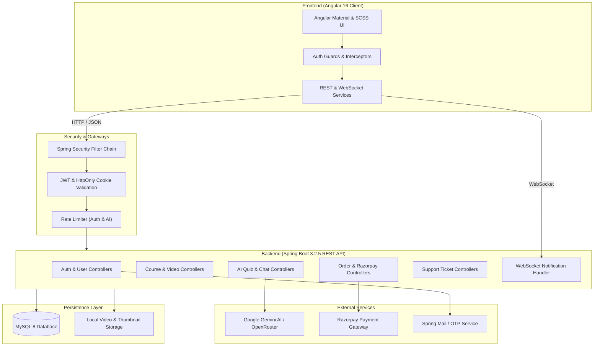

# 94aa059b-3b64-44c6-859d-a906d5df3bb7-aea7e6a9-1178-4cfd-8130-e80d0bc6b3ce
https://sonar.server.examly.io/dashboard?id=iamneo-production-2_94aa059b-3b64-44c6-859d-a906d5df3bb7-aea7e6a9-1178-4cfd-8130-e80d0bc6b3ce&amp;codeScope=overall
# 🎓 EduVerse - AI-Powered E-Learning & Course Marketplace Platform

[](https://spring.io/projects/spring-boot)
[](https://angular.io/)
[](https://openjdk.org/)
[](https://www.mysql.com/)
[](https://aistudio.google.com/)
[](https://razorpay.com/)
[](https://jwt.io/)
[](https://sonar.server.examly.io/dashboard?id=iamneo-production-2_94aa059b-3b64-44c6-859d-a906d5df3bb7-aea7e6a9-1178-4cfd-8130-e80d0bc6b3ce&codeScope=overall)

---

## 📌 Table of Contents

- [Overview](#-overview)
- [Key Features](#-key-features)
- [System Architecture](#-system-architecture)
- [User Roles & Permissions](#-user-roles--permissions)
- [Tech Stack](#-tech-stack)
- [Project Directory Structure](#-project-directory-structure)
- [Core REST API Reference](#-core-rest-api-reference)
- [Getting Started & Local Setup](#-getting-started--local-setup)
  - [Prerequisites](#prerequisites)
  - [Backend Setup (Spring Boot)](#backend-setup-spring-boot)
  - [Frontend Setup (Angular)](#frontend-setup-angular)
- [Environment Configuration](#-environment-configuration)
- [Default Seed Accounts & Credentials](#-default-seed-accounts--credentials)
- [Code Quality & SonarQube](#-code-quality--sonarqube)

---

## 📖 Overview

**EduVerse** is a full-stack, enterprise-grade E-Learning and Online Course Marketplace engineered with **Spring Boot 3 (Java 17)** and **Angular 16**. It delivers a complete digital education experience for students, instructors, and administrators, elevated with **Generative AI** capabilities including:
- **Semantic Course Search** (powered by Google Gemini embeddings)
- **Interactive AI Learning Assistant & Chatbot**
- **Dynamic AI Quiz Generation and Automated Grading**
- **Complete End-to-End E-Commerce Flow** (Cart, Razorpay Payment, Auto Invoice Generation)
- **Role-Based Workflows** with Instructor Verification, Video Curriculum Management, and Ticketing Support.

---

## 🚀 Key Features

### 🧠 1. AI-Powered Smart Learning
* **Semantic Course Search**: Natural language search powered by Google Gemini `text-embedding-004` with cosine similarity and automatic fallback to lexical search.
* **AI Quiz Engine**: Dynamically generates targeted multi-choice quizzes for any enrolled course based on selectable difficulty (`EASY`, `MEDIUM`, `HARD`) and question count (3–10), complete with immediate scoring and attempt history.
* **AI Chat Assistant**: Context-aware conversational tutor for students with message history and curriculum context.
* **Intelligent Rate Limiting**: Token-bucket and sliding window rate limits preventing AI quota exhaustion.

### 👥 2. Multi-Role Portals & Governance
* **Learner / Customer**:
  * Browse and search courses with multi-criteria filters (level, category, price).
  * Video learning player with lesson progress tracking.
  * Course reviews, ratings, and feedback summaries.
  * Shopping cart, one-click checkout, and automated PDF invoice generation.
  * Real-time notifications for enrollments, order updates, and support.
* **Instructor**:
  * Onboarding portal with application submission and verification tracking.
  * Comprehensive Course Creator Studio: create, update, price, and publish courses with thumbnails.
  * Video curriculum management: upload, organize, and stream lesson modules.
  * Instructor Dashboard: track gross sales, student enrollments, and student ratings.
* **Administrator**:
  * Centralized management dashboard with platform-wide KPI analytics.
  * Super-Admin privilege delegation (manage admin access).
  * Instructor application review, approval, rejection, and payout monitoring.
  * System-wide ticket dispatch and customer support resolution.

### 🔒 3. Enterprise Security & Identity
* **Authentication Suite**: Email OTP verification upon signup, Google OAuth2 Single Sign-On (SSO), and secure credential login.
* **Dual-Token Architecture**: Short-lived stateless JWT access tokens accompanied by hardened `HttpOnly` refresh token cookies.
* **Brute-Force Protection**: IP/Account login failure rate limiting with temporary lockout intervals.
* **Role-Based Access Control (RBAC)**: Fine-grained method-level authorization (`@PreAuthorize`) and Angular route guards (`AuthGuard`).

### 💳 4. Commerce & Integrations
* **Payment Processing**: Integrated with Razorpay Gateway for order creation, webhook verification, and payment confirmation.
* **Real-Time Communication**: WebSocket STOMP messaging for instant in-app alerts and notifications.
* **Support Ticket Desk**: Comprehensive support lifecycle with categorized tickets and status tracking (`OPEN`, `IN_PROGRESS`, `RESOLVED`, `CLOSED`).

---

## 🏛 System Architecture



---

## 👥 User Roles & Permissions

| Role | Default Access | Key Capabilities |
| :--- | :--- | :--- |
| **`CUSTOMER`** | Learners / Students | Search & enroll in courses, stream video lessons, take AI quizzes, ask AI chatbot, leave reviews, raise support tickets. |
| **`INSTRUCTOR`** | Educators / Creators | Apply for instructor status, create & manage courses, upload lessons/videos, view instructor analytics & revenue. |
| **`ADMIN`** | Platform Operations | Verify/reject instructors, oversee courses, inspect orders, resolve support tickets, manage administrative personnel. |

---

## 💻 Tech Stack

### Backend
* **Language & Framework**: Java 17, Spring Boot `3.2.5`
* **Security**: Spring Security 6, JWT (`jjwt`), OAuth2 JOSE, BCrypt Password Hashing
* **Data Access**: Spring Data JPA, Hibernate ORM
* **Database**: MySQL 8.x
* **AI & LLM Services**: Google Gemini API (`text-embedding-004`, `gemini-1.5-flash`), OpenRouter API
* **Real-time Messaging**: Spring WebSocket (`spring-boot-starter-websocket`)
* **Payments & Mail**: Razorpay SDK, Spring Boot Starter Mail (SMTP)
* **API Documentation**: SpringDoc OpenAPI 3 / Swagger UI (`2.5.0`)

### Frontend
* **Framework**: Angular `16.2.0`, Angular CLI `16.2.16`
* **Language**: TypeScript `5.1.3`, HTML5, CSS3/SCSS
* **UI Components**: Angular Material `16.2.14`, Angular CDK, Material Icons
* **Typography**: Plus Jakarta Sans, Inter
* **State & Async**: RxJS `7.8.0`
* **HTTP & Auth**: Angular HTTP Client, Functional Interceptors, `jwt-decode`

---

## 📁 Project Directory Structure

```text
├── angularapp/                         # Frontend Angular 16 application
│   ├── src/
│   │   ├── app/
│   │   │   ├── components/             # Reusable UI components & views
│   │   │   │   ├── ai-chatbot/         # AI interactive assistant widget
│   │   │   │   ├── ai-quiz/            # Dynamic AI quiz taker & results
│   │   │   │   ├── watch-course/       # Video lesson player
│   │   │   │   ├── place-order/        # Checkout & Razorpay integration
│   │   │   │   ├── admin-tickets/      # Support ticket resolution desk
│   │   │   │   └── ...
│   │   │   ├── modules/                # Feature-based lazy-loaded modules
│   │   │   │   ├── admin/              # Admin dashboard & controls
│   │   │   │   ├── auth/               # Login, register, OTP verification
│   │   │   │   ├── customer/           # Student profile, cart, orders
│   │   │   │   ├── instructor/         # Instructor hub & course management
│   │   │   │   └── tickets/            # User ticket submission & history
│   │   │   ├── services/               # Angular injectable API services
│   │   │   ├── constant.ts             # Centralized API route constants
│   │   │   └── app-routing.module.ts   # Main route definitions & RBAC guards
│   │   └── environments/               # Environment configurations
│   └── package.json                    # Frontend dependencies & scripts
│
├── springapp/                          # Backend Spring Boot 3 application
│   ├── src/main/
│   │   ├── java/com/examly/springapp/
│   │   │   ├── config/                 # Security, JWT, CORS, RateLimiter, WebSockets
│   │   │   ├── controller/             # REST API controllers
│   │   │   │   ├── AuthController.java
│   │   │   │   ├── CourseController.java
│   │   │   │   ├── CourseAiController.java
│   │   │   │   ├── AiAssistantController.java
│   │   │   │   ├── OrderController.java
│   │   │   │   ├── PaymentController.java
│   │   │   │   └── TicketController.java
│   │   │   ├── dto/                    # Request/Response Data Transfer Objects
│   │   │   ├── model/                  # JPA Entities (User, Course, Order, QuizAttempt, etc.)
│   │   │   ├── repository/             # Spring Data JPA repositories
│   │   │   ├── service/                # Business logic, Gemini AI, Razorpay, Mail
│   │   │   └── websocket/              # WebSocket configuration & handlers
│   │   └── resources/
│   │       ├── application.properties  # App configurations & credentials
│   │       └── application-prod.properties
│   └── pom.xml                         # Maven dependencies & build configuration
│
└── uploads/                            # Server uploads (course thumbnails & materials)
```

---

## 📡 Core REST API Reference

| Domain | Method | Endpoint | Access | Description |
| :--- | :---: | :--- | :--- | :--- |
| **Auth** | `POST` | `/api/register` | Public | Register new user account and trigger OTP email |
| **Auth** | `POST` | `/api/verify-otp` | Public | Verify signup OTP code |
| **Auth** | `POST` | `/api/login` | Public | Authenticate user; returns JWT token + refresh cookie |
| **Auth** | `POST` | `/api/google-login` | Public | Google OAuth2 token authentication |
| **Auth** | `POST` | `/api/refresh` | Public | Refresh expired access token via HttpOnly cookie |
| **Courses** | `GET` | `/api/course` | Public | List published courses |
| **Courses** | `GET` | `/api/course/{id}` | Public | Retrieve full details of a specific course |
| **Courses** | `POST` | `/api/course` | `INSTRUCTOR` | Create a new course offering |
| **AI Search** | `POST` | `/api/course-ai/search` | `CUSTOMER` / Public | Semantic natural-language search with Gemini |
| **AI Quiz** | `POST` | `/api/ai/quiz/generate` | `CUSTOMER` | Generate customized quiz for an enrolled course |
| **AI Quiz** | `POST` | `/api/ai/quiz/submit` | `CUSTOMER` | Submit quiz answers and retrieve graded result |
| **AI Quiz** | `GET` | `/api/ai/quiz/history` | `CUSTOMER` | Retrieve student's previous quiz attempts |
| **AI Chat** | `POST` | `/api/ai/chat` | `CUSTOMER` | Conversational tutor chatbot response |
| **Cart** | `GET` | `/api/cart/user/{userId}` | `CUSTOMER` | Fetch customer's active shopping cart |
| **Cart** | `POST` | `/api/cart` | `CUSTOMER` | Add course item to cart |
| **Orders** | `POST` | `/api/order` | `CUSTOMER` | Create new course order |
| **Payment** | `POST` | `/api/payment/create-order` | `CUSTOMER` | Initialize Razorpay payment order |
| **Payment** | `POST` | `/api/payment/verify` | `CUSTOMER` | Verify Razorpay payment signature & confirm order |
| **Tickets** | `POST` | `/api/tickets` | Authenticated | Create a support ticket |
| **Tickets** | `GET` | `/api/admin/tickets` | `ADMIN` | Retrieve all platform support tickets |
| **Admin** | `GET` | `/api/admin/users` | `ADMIN` | View and manage platform administrators |

> 💡 **Interactive Swagger UI**: When running the backend locally, explore and test all endpoints interactively at `http://localhost:8080/swagger-ui.html`.

---

## 🛠 Getting Started & Local Setup

### Prerequisites
Make sure the following tools are installed on your machine:
* **Java Development Kit (JDK) 17+**
* **Node.js (v18.x or v20.x)** & **npm**
* **Angular CLI** (`npm install -g @angular/cli@16`)
* **MySQL Server 8.x**
* **Git**

---

### Backend Setup (Spring Boot)

1. **Configure MySQL Database**:
   Create a database named `appdb` (or ensure MySQL is running on port 3306):
   ```sql
   CREATE DATABASE appdb CHARACTER SET utf8mb4 COLLATE utf8mb4_unicode_ci;
   ```

2. **Navigate to the Backend Directory**:
   ```bash
   cd springapp
   ```

3. **Verify Configuration**:
   Check `src/main/resources/application.properties` and ensure your database credentials match:
   ```properties
   spring.datasource.url=jdbc:mysql://localhost:3306/appdb?createDatabaseIfNotExist=true&useSSL=false&allowPublicKeyRetrieval=true&serverTimezone=UTC
   spring.datasource.username=root
   spring.datasource.password=your_mysql_password
   ```

4. **Build and Run the Server**:
   * On Linux/macOS:
     ```bash
     ./mvnw clean spring-boot:run
     ```
   * On Windows:
     ```cmd
     mvnw.cmd clean spring-boot:run
     ```
   The backend will start at `http://localhost:8080`.

---

### Frontend Setup (Angular)

1. **Navigate to the Frontend Directory**:
   ```bash
   cd angularapp
   ```

2. **Install Dependencies**:
   ```bash
   npm install --legacy-peer-deps
   ```

3. **Run the Development Server**:
   ```bash
   npm start
   # or
   ng serve --port 8081
   ```

4. **Access the Application**:
   Open your browser and navigate to:
   ```
   http://localhost:8081
   ```

---

## ⚙️ Environment Configuration

You can override application settings using environment variables or directly in `application.properties`:

| Variable | Description | Default |
| :--- | :--- | :--- |
| `DB_URL` | MySQL JDBC URL | `jdbc:mysql://localhost:3306/appdb` |
| `DB_USERNAME` | Database username | `root` |
| `DB_PASSWORD` | Database password | `examly` |
| `JWT_SECRET` | Secret key for signing JWTs | *(Configured default key)* |
| `GEMINI_API_KEY` | Google Gemini AI Studio API Key | *(Configured in properties)* |
| `LLM_API_KEY` | OpenRouter API Key (Fallback LLM) | *(Configured in properties)* |
| `ADMIN_EMAIL` | Super-admin email address | `admin@elearning.com` |
| `ADMIN_PASSWORD` | Super-admin password | `Admin@12345` |
| `CORS_ORIGINS` | Permitted CORS frontend origins | `http://localhost:8081, http://localhost:4200` |

---

## 🔑 Default Seed Accounts & Credentials

Upon application startup, an initial administrator account is automatically initialized:

| Role | Username / Identifier | Password | Access Level |
| :--- | :--- | :--- | :--- |
| **Super Admin** | `admin@elearning.com` | `Admin@12345` | Complete platform governance & admin management |
| **New Learner** | *Self-register via UI* | *Chosen during signup* | Course browsing, purchase, AI quiz/assistant |
| **Instructor** | *Apply via UI* | *Chosen during signup* | Course creation upon Admin approval |

---

## 📊 Code Quality & SonarQube

This project adheres to strict coding standards with automated static code analysis, vulnerability scanning, and code smell tracking:

* **SonarQube Dashboard**: [SonarQube Project Quality Gate](https://sonar.server.examly.io/dashboard?id=iamneo-production-2_94aa059b-3b64-44c6-859d-a906d5df3bb7-aea7e6a9-1178-4cfd-8130-e80d0bc6b3ce&codeScope=overall)
* **Sonar Project Key**: `iamneo-production-2_94aa059b-3b64-44c6-859d-a906d5df3bb7-aea7e6a9-1178-4cfd-8130-e80d0bc6b3ce`

---

## 📄 License & Attribution

This project is developed as part of the advanced full-stack enterprise curriculum on Examly / Neo.  
All rights reserved © 2026 EduVerse Development Team.
